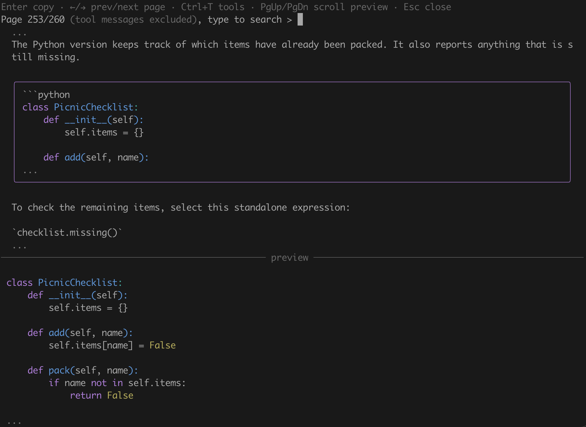

# Pi copy picker

Browse and copy messages from the current Pi branch with `/copy-picker`.
The fullscreen picker has a paginated message list above a Markdown preview.
It selects the newest visible message and closes after a successful copy.



Requires interactive TUI mode and `@earendil-works/pi-coding-agent` and `@earendil-works/pi-tui` version 1.0.0 or newer. The host supplies these optional peer dependencies.
Tests have passed with versions 1.0.0 and 1.4.0.

## Open the picker

Install the package in Pi:

```sh
pi install npm:pi-copy-picker
```
Run `/copy-picker` in Pi. Use `/reload` or restart an existing session after installation or source changes.
The command does not change history or tool configuration.

## Copy the last block

Run `/copy-block` or press Ctrl+Shift+B in the main editor to copy the last selectable block in the latest grouped assistant reply on the current branch. If that message has no selectable block, it copies the whole message instead. It uses the same block and clipboard rules as the picker, ignores thinking and tool messages, and skips aborted empty assistant messages. It does not fall back to an older message when the latest message has no copyable text.

Ctrl+Shift+B requires a terminal that distinguishes it from Ctrl+B. The terminal, operating system, or another binding may intercept it. Use `/copy-block` if the shortcut does not reach Pi. Both require TUI mode and leave the editor and conversation unchanged.

## Controls

| Key | Action |
| --- | --- |
| Up / Down | Select the whole message, then its code, inline-code, and blockquote children in source order, then the next message. Up reverses this order. No wrapping |
| Left / Right | Change page. Select its first message only when a selection is already active |
| Type | Edit the search, ignoring case, and clear selection and preview immediately |
| Ctrl+A / Ctrl+E | Move the search cursor to the start or end |
| Ctrl+U / Ctrl+K | Delete search text before or after the cursor |
| Ctrl+T | Show or hide tool calls and results, hidden by default |
| Enter | Copy an active selection and close on success. Do nothing when no message is selected |
| PgUp / PgDown | Scroll the preview by one page |
| Shift+Up / Shift+Down | Scroll the preview by one line |
| Ctrl+Home / Ctrl+End | Jump to the start or end of the preview |
| Esc | Close, even during a pending copy or an active search |

Pi's configured selection, confirm, and cancel keys also work. Fixed keys take priority.
A small-window message appears below 32 columns or when the list has fewer than three rows for the selected frame. Search and Escape still work; copying waits until the frame fits.

## Message and clipboard behavior

The picker reads the current branch when it opens. Reopen it to see newer messages. It excludes abandoned branches, thinking, and images.

Select a whole message, a code block, a standalone inline-code line, or a blockquote. The list shows Markdown source; the preview renders the selected content. Long selections are shortened in the list, but preview and copy include the complete selection.

Code copies without fences or Markdown container prefixes. Standalone inline code copies without backticks. Blockquotes copy without the outer quote marker. Images are not copied. Tool calls copy formatted arguments, and tool results copy text.

Search matches messages and tool names and shows the number of matching items. Changing the query clears the selection; use Up or Down to select a result before copying.

Copy uses Pi's clipboard helper. Remote sessions may require OSC 52 support in the terminal and multiplexer. Large copies may fail when no local clipboard is available. If copying fails, the picker stays open for retry.

Only displayed text has terminal control sequences removed. Do not paste untrusted copied text directly into a shell.

## Development

See [Development](https://github.com/tallshort/pi-copy-picker/blob/main/DEVELOPMENT.md) for local setup and implementation details. See [Release the package](RELEASING.md) for publication instructions.
