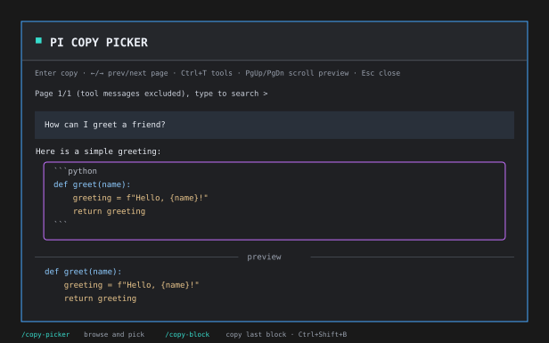

# Pi copy picker



Browse and copy messages from the current Pi branch with `/copy-picker`.
The fullscreen picker has a paginated message list above a Markdown preview.
It selects the newest visible message and closes after a successful copy.


Requires interactive TUI mode and `@earendil-works/pi-coding-agent` and `@earendil-works/pi-tui` version 1.0.0 or newer. The host supplies these optional peer dependencies.
Type checking and tests passed with 1.0.0 and 1.4.0. Other versions are accepted but have not been verified here.

## Open the picker

From a source checkout, load the TypeScript entry directly:

```sh
	pi -e ./src/index.ts
```

For directory installation, run these commands from the checkout. No build is required:

```sh
	pi install "$PWD"
	pi -e .
```

After the first npm publication, install the published package with:

```sh
	pi install npm:pi-copy-picker
```

Run `/copy-picker` in Pi. Use `/reload` or restart an existing session after installation or source changes.
The command does not change history or tool configuration.

## Copy the last block

Run `/copy-block` or press Ctrl+Shift+B in the main editor to copy the last selectable block in the latest grouped assistant reply on the current branch. If that message has no selectable block, it copies the whole message instead. It uses the same block and clipboard rules as the picker, ignores thinking and tool messages, and skips aborted empty assistant messages. It does not fall back to an older message when the latest message has no copyable text.

Ctrl+Shift+B requires a terminal that distinguishes it from Ctrl+B. The terminal, operating system, or another binding may intercept it. Use `/copy-block` if the shortcut does not reach Pi. Both require TUI mode and leave the editor and conversation unchanged.

## Controls

| Key | Action |
| --- | --- |
| Up / Down | Select the whole message, then its code, inline-code, and blockquote children in source order, then the next message. Up reverses this order. No wrapping |
| Left / Right | Change page. Select its first message only when a selection is already active |
| Type | Edit the search, ignoring case, and clear selection and preview immediately |
| Ctrl+A / Ctrl+E | Move the search cursor to the start or end |
| Ctrl+U / Ctrl+K | Delete search text before or after the cursor |
| Ctrl+T | Show or hide tool calls and results, hidden by default |
| Enter | Copy an active selection and close on success. Do nothing when no message is selected |
| PgUp / PgDown | Scroll the preview by one page |
| Shift+Up / Shift+Down | Scroll the preview by one line |
| Ctrl+Home / Ctrl+End | Jump to the start or end of the preview |
| Esc | Close, even during a pending copy or an active search |

Pi's configured selection, confirm, and cancel keys also work. Fixed keys take priority.
A small-window message appears below 32 columns or when the list has fewer than three rows for the selected frame. Search and Escape still work; copying waits until the frame fits.

## Message and clipboard behavior

Each opening reads a saved `getBranch()` snapshot, including original text before compaction.
Abandoned branches are excluded. Reopen the picker to load newer messages.
Thinking, signatures, system messages, custom messages, and administrative entries are excluded. Assistant text records connected by tool-use steps form one reply, ending at stop, error, abort, a user message, or another history boundary. When tools are shown, unselected assistant text and tool events follow their original branch order.

User cards use the chat theme's user background and text colors. Assistant cards have no background.
The selected card has an accent border. Tool cards retain a dim border and the tool name.
The upper list shows original Markdown source in conversation order. Headings, lists, tables, references, and blank source lines stay literal. Long context lines wrap at the list width.
Each selected target has an accent frame with up to seven interior rows. The frame grows with its content and shrinks to fit short windows. Source lines appear in order, including code fences and punctuation. A single blank line stays blank. A run of blank lines becomes a muted `...`. If the source or its wrapped lines exceed the available rows, the last row is a muted `...`. Literal `...` remains ordinary source text. Preview and copy retain the complete selected entity. When tools are shown, a selected grouped reply frames its first segment and adds a muted `...` inside the frame if later segments contain text. Later segments remain unframed after their tool events. Preview and copy cover the whole reply. Selecting a block replaces only its original source interval. If a block spans tool events, its frame appears at the block's start and may summarize text that originally followed those events. The tool events remain in their original order, and text after the block remains visible. Changing selection centers the new frame, clamped at history ends. Reserved `...` rows indicate additional list content above and below. The bottom Pi-rendered preview shows only the selected entity.
A local source scanner finds fenced and indented code and nonempty blockquotes. Pi's Markdown tokenizer identifies standalone inline-code lines. These are the only selectable children. A standalone inline-code line contains one nonempty span and copies its content without backticks. Inline code within a sentence does not create a separate block. Lists, headings, tables, and prose remain in the whole-message preview and copy, but do not create children.
Search matches whole messages and tool names, so matching messages retain all their children.
Search filters as you type. Every effective query edit clears selection and preview. Clearing the query immediately restores all messages. Down selects the first message on the visible page and Up selects the last, without needing Enter first. Repeated Enter presses do nothing until you select a message.
While selection is inactive, the preview shows the dim, centered prompt `Use ↑/↓ to select a message`. Paging, tool visibility, preview scrolling, and resizing do not activate selection.
Block frames leave two columns on both sides. Parent frames use the full width. Block frames have no type labels. Code excerpts show the original fence lines, language info and quote/list prefixes when they fit. Unclosed fences get no invented closing marker. Indented code keeps its source indentation without added fences. Code previews show only the highlighted body, and code copy still excludes fences and container prefixes.

Source display lines and preview Markdown rendering are cached per message or block until width or theme changes. Many long messages can increase memory use until the picker closes.

Whole-message copy joins original text blocks within a record with newlines and preserves surrounding whitespace. For grouped assistant records it adds enough newline characters at each seam to make a paragraph separator of at least two line breaks, preserving existing line breaks. A single record stays unchanged.
Blockquote children copy plain text with one outer `>` prefix and at most one following space or tab removed per line. Quoted blank paragraphs stay in one target. Nested quote prefixes, internal whitespace, and line endings are preserved. Lazy continuation lines stay unchanged until an unquoted blank paragraph. Empty quotes have no child. Quote previews still render the original Markdown. Code children copy only code, without fences or Markdown quote/list prefixes. Copy removes trailing newline characters from code and quote blocks while preserving indentation, spaces, and internal line endings.
Quote fences stop when their quote container ends. List code indentation is measured four spaces beyond the list content indentation. A dedented nonblank line ends that list context.
The scanner covers space-indented lists and these common block forms rather than the full CommonMark grammar. Tab-expanded list indentation and lazy container continuation are not parsed as full CommonMark containers. All source remains available in the whole-message copy. Inline-code children require an unambiguous top-level paragraph token. Some valid spans in nested or otherwise ambiguous Markdown are skipped. Pi still renders and syntax-highlights the previews.
Images are not copied. Empty messages and image-only messages show `No copyable text`.
Tool calls copy formatted argument JSON, not the original request bytes.
Tool results copy text blocks without their `details` field.
Only displayed text has terminal control sequences removed. Do not paste untrusted copied text directly into a shell.
Generated UI text is English. Original messages keep their language.

Copy uses Pi's clipboard helper. Remote sessions may depend on OSC52 support in the terminal and multiplexer.
Pi 1.4.0 limits OSC52 to 100000 Base64 characters. Large copies can fail without a local clipboard backend.
Repeated Enter presses do not submit duplicate copies while a copy is pending. A failure leaves the picker open for retry.

In fullscreen Pi, success uses the native transient `flash("Copied!")`.
In regular Pi, success uses `ctx.ui.notify` with `Copied message to clipboard`, without a dismissal timer.
Success means the helper returned, not that the terminal confirmed clipboard contents.

## Develop in a local sandbox

On Linux with a shared virtiofs checkout, keep `node_modules` outside the checkout.
Copy the source to a sandbox-local directory. Repeat the copy when source or metadata changes.
Run the following from the checkout, using a fresh or dedicated `/tmp/pi-copy-picker-dev` directory:

```sh
	mkdir -p /tmp/pi-copy-picker-dev
	tar --exclude='./node_modules' --exclude='./.git' --exclude='*.tgz' -cf - . | tar -xf - -C /tmp/pi-copy-picker-dev
	cd /tmp/pi-copy-picker-dev
	npm ci
	npm run check
	npm pack
```

Stop if dependency installation fails. Run checks only after `npm ci` succeeds.
`check` runs type checking, runtime tests, release guard tests, and a real tarball contract check.
`prepack` runs the same checks. The package checker uses `--ignore-scripts` to avoid recursive packing.
The package ships the three TypeScript source modules. Pi loads them with its TypeScript loader.
The package checker extracts the tarball and uses Pi's loader to verify command registration.
The entry is for Pi, not a promise that plain Node can execute the TypeScript source.

`src/history.ts` converts history. `src/picker.ts` owns selection, search, scrolling, and copy state.
`src/index.ts` registers the command. Tests use the real Input, Markdown renderer, and key parser with injected clipboard and dimensions.
IME positioning and actual clipboard reception still need checks in your target terminal.

For publication prerequisites and tag commands, see [Release the package](RELEASING.md).
The [MIT license](LICENSE) and [changelog](CHANGELOG.md) ship with the package.

Maintained by tallshort. Repository: [tallshort/pi-copy-picker](https://github.com/tallshort/pi-copy-picker).
